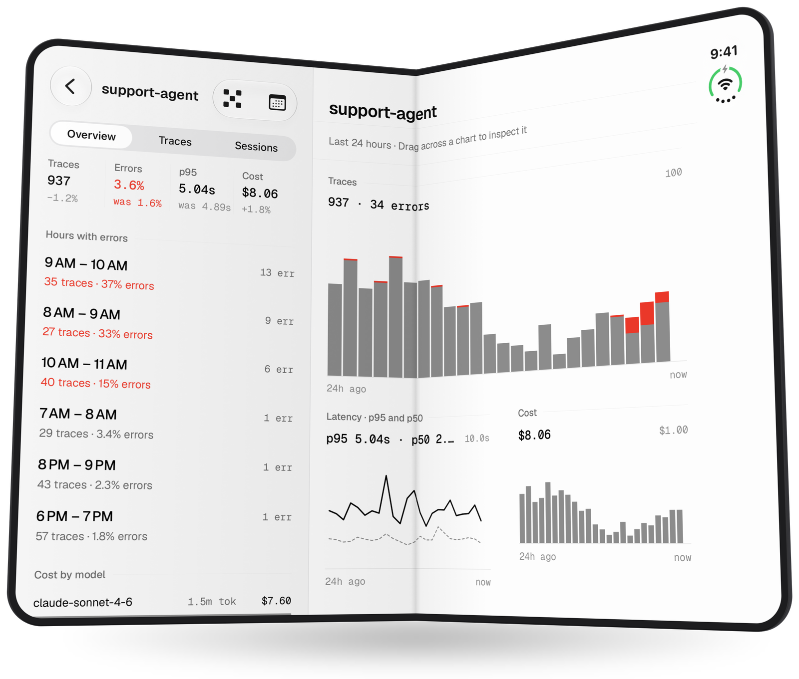
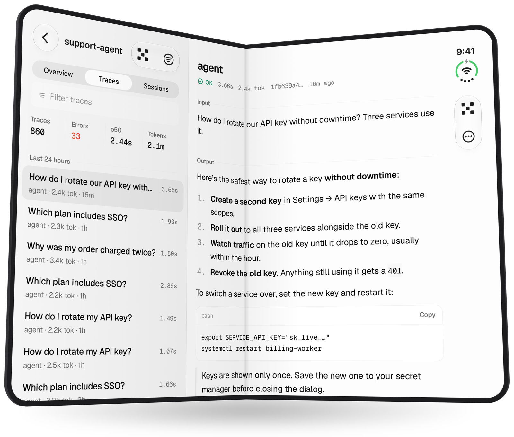

# Phoenix Mobile

Your [Arize Phoenix](https://github.com/Arize-ai/phoenix) instances, in your pocket. A native companion for self-hosted Phoenix that shows which projects need attention, charts their traffic, errors, latency, and cost, while letting you deep dive any traces. It also brings PXI along so you can ask about them. iOS is first-class and Android is best effort.

<p align="center">
  <picture>
    <source media="(prefers-color-scheme: dark)" srcset="docs/images/duo-overview-dark.png">
    
  </picture>
</p>

## What you get

- **Health at a glance.** Every project gets a traffic pulse, and error spikes, projects gone quiet, and slower p95 latency rise to "Needs attention".
- **Project Overview.** Traces, errors, latency, cost, top models, and eval scores over the last hour, day, week, or month. Scrub a chart and tap a bar to open its traces.
- **Traces and sessions.** Filter with Phoenix expressions or plain English, using Apple Intelligence on the device or the instance's PXI model.
- **PXI.** Stream chats that live in server-side agent sessions, shared with every other PXI client.
- **Offline.** Read anything you have opened. Annotations, notes, and dataset adds queue until the server is back.
- **Big screens.** Native split columns on iPad and the iPhone Duo, in light and dark.
- **Sign-in.** Connect to open servers, or sign in to authenticated ones with OAuth 2.

The Overview and health list need Phoenix 11.11.0 or newer, OAuth needs 19, and PXI chats need 20.

<p align="center">
  <picture>
    <source media="(prefers-color-scheme: dark)" srcset="docs/images/duo-trace-dark.png">
    
  </picture>
</p>

## Try it in Expo Go

No Xcode or Android Studio needed. Put the phone and the computer on the same Wi-Fi network, install [Expo Go](https://expo.dev/go) (SDK 58), then:

```bash
vp install
vp run start:go   # add --tunnel if the phone can't reach the computer
```

Scan the QR code, tap **Add instance**, and enter the computer's LAN address, such as `192.168.1.20:6006`. On the phone, `localhost` is the phone itself.

Need a Phoenix server? Start one with `uvx --from 'arize-phoenix[pg]' phoenix serve` or `docker run -p 6006:6006 arizephoenix/phoenix:latest`, then send it traces with the [tracing quickstart](https://arize.com/docs/phoenix/tracing/llm-traces-1).

Expo Go can't show the iPad and Duo split columns, on-device Ask, or OAuth sign-in. Those need a development build.

## Develop

You need Node 22 or newer (`.nvmrc` pins it) and [Vite+](https://viteplus.dev) (`vp`), which runs every install, script, and check over npm.

```bash
vp install
vp run start   # Metro for the installed development build
vp run check   # format, type-aware lint, type check, and tests
```

Extra arguments go straight after the script name, as in `vp run start:go --tunnel`. A `--` separator would be passed to the script as an argument.

**iPhone.** Copy `.env.example` to `.env.local`, set `PHOENIX_IOS_BUNDLE_ID` (and `PHOENIX_APPLE_TEAM_ID` if you like), and turn on Developer Mode. Then build and install:

```bash
vp run ios:device:clean "My iPhone"
```

After that, `vp run start` gives you Fast Refresh. For a standalone build that runs without Metro, use `vp exec expo run:ios --device "My iPhone" --configuration Release --no-bundler`.

**Android.** See [docs/android-development.md](./docs/android-development.md).

**Hosted Phoenix.** Behind a TLS-terminating proxy such as Railway, Render, or a load balancer, set `PHOENIX_ROOT_URL` to the server's public `https://` address. Otherwise Phoenix advertises an `http://` OAuth issuer, and the app refuses to sign in.

## Read next

- [`AGENTS.md`](./AGENTS.md): how to work in this repository and where things live. Start here.
- [`FINDINGS.md`](./FINDINGS.md): technical constraints and decisions.
- [`GOALS.md`](./GOALS.md): product priorities.
- [`docs/design.md`](./docs/design.md) and [`docs/iphone-duo.md`](./docs/iphone-duo.md): the design system and the split-column layout.
